<!-- 由 `pnpm readme` 生成：要改内容请修改 profile.config.ts 或 src/ 后重新生成，不要直接改这个文件。 -->

<picture><source media="(max-width: 600px)" srcset="https://github.com/ZoveRKI/ZoveRKI/raw/main/assets/phone/header.svg"></picture>
<picture><source media="(max-width: 600px)" srcset="https://github.com/ZoveRKI/ZoveRKI/raw/main/assets/phone/contributions.svg"></picture>
<picture><source media="(max-width: 600px)" srcset="https://github.com/ZoveRKI/ZoveRKI/raw/main/assets/phone/activity.svg"></picture>
<picture><source media="(max-width: 600px)" srcset="https://github.com/ZoveRKI/ZoveRKI/raw/main/assets/phone/languages.svg"></picture>
<picture><source media="(max-width: 600px)" srcset="https://github.com/ZoveRKI/ZoveRKI/raw/main/assets/phone/projects.svg"></picture>
<a href="https://github.com/ZoveRKI/OneByOne"><picture><source media="(max-width: 600px)" srcset="https://github.com/ZoveRKI/ZoveRKI/raw/main/assets/phone/projects/onebyone.svg"></picture></a>
<a href="https://github.com/ZoveRKI/Voice-Synthesis"><picture><source media="(max-width: 600px)" srcset="https://github.com/ZoveRKI/ZoveRKI/raw/main/assets/phone/projects/voice-synthesis.svg"></picture></a>
<a href="https://github.com/ZoveRKI/ZoveRKI"><picture><source media="(max-width: 600px)" srcset="https://github.com/ZoveRKI/ZoveRKI/raw/main/assets/phone/footer.svg"></picture></a>

